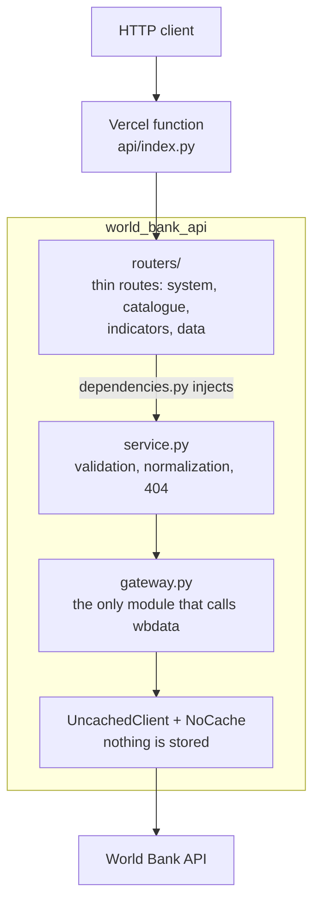
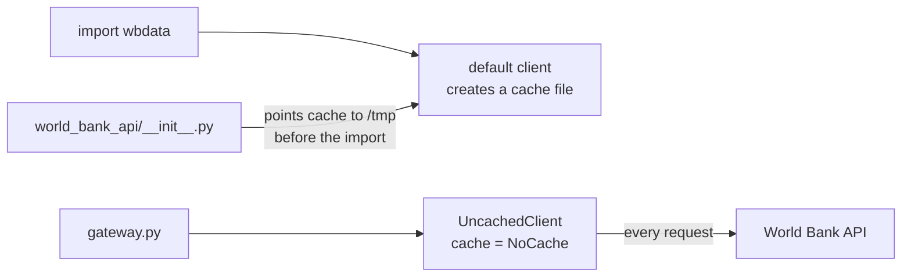
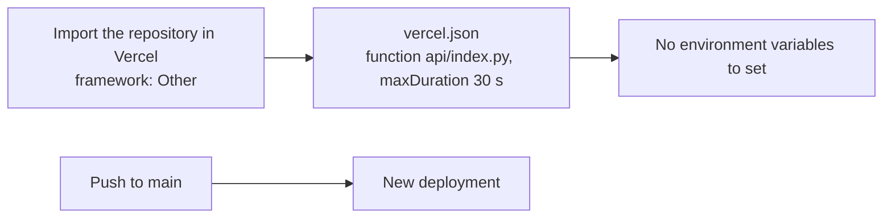

# FinBrain World Bank Data Server

A stateless HTTP API over the **World Bank** open data, built with the
[`wbdata`](https://github.com/OliverSherouse/wbdata) library and FastAPI. Every
request is answered by the World Bank API at the moment of the call. The server
**does not use a cache** and does not write anything to disk, which makes it
possible to run it as a serverless function on Vercel.

The full documentation, in English, is in Swagger at `/docs` (or `/redoc`).

## Contents

- [Routes](#routes)
- [Errors](#errors)
- [Architecture](#architecture)
- [Why there is no cache](#why-there-is-no-cache)
- [Configuration](#configuration)
- [Running locally](#running-locally)
- [Testing](#testing)
- [Deployment on Vercel](#deployment-on-vercel)
- [Data](#data)

## Routes

| Method | Route | What it does |
|---|---|---|
| GET | `/health` | Liveness check of the process (does not query the World Bank) |
| GET | `/version` | Version of the server and of `wbdata` |
| GET | `/sources` | Data sources (WDI, Doing Business, ...) |
| GET | `/sources/{source_id}` | One source by id |
| GET | `/topics` | Thematic topics |
| GET | `/topics/{topic_id}` | One topic by id |
| GET | `/countries` | Countries and aggregates, with the filters `country_id`, `query`, `incomelevel` and `lendingtype` |
| GET | `/countries/{country_id}` | One country or aggregate by its ISO3 code |
| GET | `/income-levels` | Income groups |
| GET | `/lending-types` | Lending types (IBRD, IDA, blend) |
| GET | `/indicators` | Indicator search by code, name, source or topic |
| GET | `/indicators/{code}` | Metadata of one indicator |
| GET | `/data/{code}` | Observations of one indicator (list of records) |
| GET | `/series/{code}` | Time series of one indicator for one country (`date`/`value`) |
| POST | `/data/table` | Several indicators in one table (one record per period) |

## Errors

Every error response has the same body, `{"code": "...", "message": "..."}`:

| Status | Code | When |
|---|---|---|
| 400 | `invalid_request` | Invalid parameter (frequency, period without a start, filter rejected by the API) |
| 404 | `not_found` | Nothing matches the request, the id or code does not exist, or there is no data for the requested frequency |
| 502 | `upstream_unavailable` | The World Bank API did not answer |

## Architecture



Each layer only knows the layer below it: the routes call the service, the
service calls the gateway, and only the gateway knows `wbdata`. This is why the
route tests use a fake gateway and make no network calls.

| Module | Responsibility |
|---|---|
| `__init__.py` | Moves the `wbdata` cache to the temporary directory, before any import |
| `config.py` | Title, version, Swagger description and tags |
| `errors.py` | Application errors and the HTTP status of each one |
| `gateway.py` | The only module that calls `wbdata`; client without cache |
| `service.py` | Business rules: validation, normalization, 404 |
| `schemas.py` | Response models (they document Swagger) |
| `dependencies.py` | How routes receive the service (replaceable in tests) |
| `main.py` | Application factory, error handling, OpenAPI |
| `routers/` | Thin routes: system, catalogue, indicators, data |

`api/index.py` is the Vercel entry point. `tests/` has unit tests for every
route and every layer.

## Why there is no cache

`wbdata` keeps a file-based response cache. On Vercel the file system is
read-only, except `/tmp`, and creating that file caused failures. Therefore:

- `world_bank_api/__init__.py` points the library's default cache to the
  temporary directory, before `wbdata` is imported (the import already creates a
  default client);
- `gateway.py` uses an `UncachedClient`, whose cache is a `NoCache` that never
  stores anything. Every call goes to the World Bank API;
- the tests check that the client uses `NoCache` and that no new file appears in
  the cache directory.



## Configuration

There are no required environment variables. The server keeps no state.

## Running locally

```bash
uv venv .venv
uv pip install --python .venv/Scripts/python.exe -r requirements.txt
.venv\Scripts\python.exe -m uvicorn api.index:app --port 8200
```

Then open `http://127.0.0.1:8200/docs`.

## Testing

```bash
uv pip install --python .venv/Scripts/python.exe -r requirements-dev.txt
.venv\Scripts\python.exe -m pytest -v
```

The tests need no internet access: the gateway is replaced by a fake one in the
route tests, and the `wbdata` HTTP client is replaced in the gateway tests.

## Deployment on Vercel



1. Import the repository in Vercel (framework: *Other*).
2. `vercel.json` declares the function `api/index.py` (`maxDuration` 30
   seconds). There are no environment variables to set.
3. Every push to `main` creates a deployment.

## Data

The data belongs to the World Bank and is published under its open data terms.
Keep the `source` field of the responses when you republish the data.
